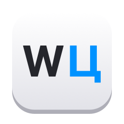
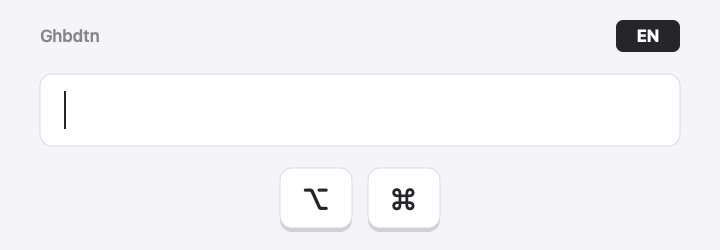

<p align="center"></p>

# Ghbdtn

A tiny macOS menu bar app that fixes text typed in the wrong keyboard layout. Press **⌥⌘** and
`ghbdtn rfr ltkf` becomes `привет как дела` — and the system layout switches so you can keep typing.
A free, open-source alternative to Punto Switcher and Caramba Switcher for Mac (English ↔ Russian).

<p align="center"></p>

[Русский ниже ↓](#по-русски)

## Install

**Homebrew:**

```bash
brew tap achubnet/tap
brew trust --cask achubnet/tap/ghbdtn   # Homebrew 7+ asks to trust third-party casks
brew install --cask ghbdtn
```

**Or download** `Ghbdtn-<version>.dmg` from [Releases](https://github.com/achubnet/Ghbdtn/releases/latest)
and drag Ghbdtn to Applications.

**First launch.** Ghbdtn is not notarized by Apple yet, so macOS blocks it the first time:
open it once, then go to System Settings → Privacy & Security and click **Open Anyway**.
After that, allow Ghbdtn in Privacy & Security → **Accessibility** — it needs this to see the
hotkey and to copy and paste the text.

## Features

- **⌥⌘ tap** (press and release Option + Command, nothing else) converts:
  - the **selection**, if there is one;
  - otherwise the **last word before the cursor** — symbols included, so `nj;t` → `тоже`.
- **Per-letter**: every letter flips to the other layout, so mixed text works too:
  `ghbdtn как дела` → `привет rfr ltkf`. Case is preserved.
- **Layout follows**: after replacing, the keyboard layout switches to the script of the last
  converted letter, where the cursor is.
- **Uses your real layouts**: the key map is built from the layouts enabled in macOS
  (`UCKeyTranslate`), so ABC / U.S. ↔ Russian / Russian – PC all work.
- **Clipboard is restored** after each conversion.
- **Works where ⌘C/⌘V don't** (menu bar apps without an Edit menu): falls back to reading and
  writing the text field through the Accessibility API.
- **Lightweight**: event-driven, no polling; 0% CPU when idle, ~20 MB RAM.
- Menu bar menu: *Launch at login* (on by default) and *Quit*.

## Requirements

- macOS 13 or later
- One Latin and one Cyrillic keyboard layout enabled
- Accessibility permission (System Settings → Privacy & Security → Accessibility) — needed to
  watch the hotkey and send ⌘C/⌘V

## Build from source

```bash
git clone git@github.com:achubnet/Ghbdtn.git
cd Ghbdtn
./build.sh --install
```

Builds a release, signs it with your first `Apple Development` certificate (ad-hoc if none),
copies `Ghbdtn.app` to `/Applications` and launches it. Without `--install` it only builds into
`build/`. Requires Xcode (for `actool`).

A stable signing identity keeps the Accessibility permission across rebuilds; with ad-hoc signing
you will have to grant it again after each build.

## Tests

```bash
swift test
```

`LayoutCore` holds everything that decides what happens — script detection, the layout map, the
hotkey detector, the selection guess and the conversion flow itself (`SelectionConverter`). The
flow talks to the system only through three protocols (`ClipboardTextIO`, `AccessibilityTextIO`,
`LayoutSwitching`), so the tests run every scenario against a fake text field.

`Sources/Ghbdtn` implements those protocols over the real system (pasteboard and synthetic key
events, the Accessibility API, Text Input Sources) and wires them up with the input monitor,
the menu and the login item.

## How it works

1. A global `NSEvent` monitor watches modifier changes; a clean ⌥⌘ tap triggers a conversion.
2. If there may be a selection, Ghbdtn sends ⌘C and reads the clipboard. Otherwise it selects from
   the line start (⇧⌘←), copies, finds the last whitespace-delimited token, narrows the selection
   to it with ⇧→ and **verifies** with another ⌘C — on any mismatch it leaves the text alone.
3. Converted text is pasted with ⌘V, the clipboard is restored, and the layout is switched.

## License

MIT

---

## По-русски

Бесплатная альтернатива Punto Switcher для Mac с открытым кодом. Маленькое приложение для строки
меню macOS исправляет текст, набранный не в той раскладке: нажали **⌥⌘** — `ghbdtn rfr ltkf`
превращается в `привет как дела`, а раскладка переключается.

- Короткое нажатие **⌥⌘** (без других клавиш) переводит выделенный текст, а без выделения —
  последнее слово перед курсором, включая символы: `nj;t` → `тоже`.
- Каждая буква переводится по своему алфавиту, регистр сохраняется:
  `ghbdtn как дела` → `привет rfr ltkf`.
- Раскладка переключается на алфавит последней буквы — там, где курсор.
- Таблица строится из включённых в системе раскладок, буфер обмена восстанавливается.
- В простое не нагружает систему: 0% CPU, ~20 МБ.

**Установка:** через Homebrew (команды выше, в разделе Install) или скачайте `.dmg` из
[Releases](https://github.com/achubnet/Ghbdtn/releases/latest) и перетащите Ghbdtn в «Программы».

**Первый запуск.** Приложение пока не нотаризовано Apple, поэтому macOS в первый раз его
заблокирует: откройте его, затем «Настройки → Конфиденциальность и безопасность» → **«Всё равно
открыть»**. После этого разрешите Ghbdtn в разделе **«Универсальный доступ»** там же.
